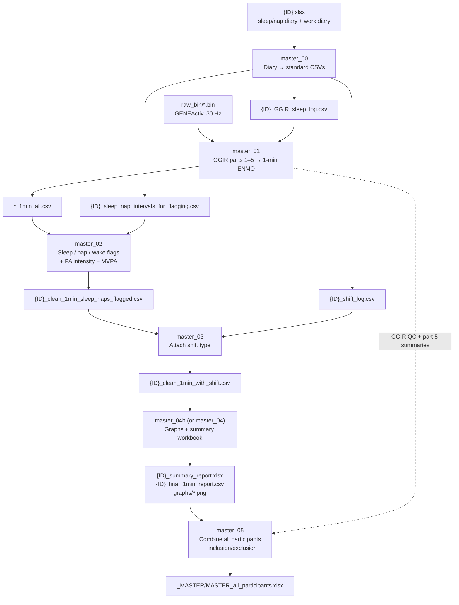

# ER-DOCTOR-ACCELEROMETRY-GGIR

R processing pipeline for the BHSc Honours thesis:

> **Accelerometry-derived Physical Activity Patterns in Western Cape Emergency Room Doctors**
> Judd Greenhill · BHSc Honours in Neuroscience · Department of Anatomical Sciences, University of the Witwatersrand · 2026
> Supervisors: Dr Joshua Davimes and Ms Thabisile Cindi

The pipeline takes raw GENEActiv `.bin` files, sleep/nap diaries and shift diaries. It turns them into minute-by-minute physical activity (PA) data, with each minute labelled by sleep/nap/wake state and by shift type. It then builds per-participant reports and a combined workbook for the whole cohort, with inclusion/exclusion criteria applied.

> [!IMPORTANT]
> **This repository contains code only.** It holds no participant data (raw, processed or summary), and no data will be shared. See [Data availability](#data-availability).

---

## Contents

1. [Study overview](#study-overview)
2. [Data availability](#data-availability)
3. [Pipeline at a glance](#pipeline-at-a-glance)
4. [Repository structure](#repository-structure)
5. [Requirements](#requirements)
6. [Installation](#installation)
7. [Expected folder layout](#expected-folder-layout)
8. [Input files](#input-files)
9. [Configuration](#configuration)
10. [Running the pipeline](#running-the-pipeline)
11. [Script reference](#script-reference)
12. [GGIR settings](#ggir-settings)
13. [Classification rules](#classification-rules)
14. [Shift assignment rules](#shift-assignment-rules)
15. [Outputs](#outputs)
16. [Inclusion and exclusion criteria](#inclusion-and-exclusion-criteria)
17. [Built-in quality checks](#built-in-quality-checks)
18. [Assumptions and limitations](#assumptions-and-limitations)
19. [What is not in this repository](#what-is-not-in-this-repository)
20. [Troubleshooting](#troubleshooting)
21. [How to cite](#how-to-cite)
22. [References](#references)
23. [Licence](#licence)
24. [Acknowledgements](#acknowledgements)

---

## Study overview

Sixty-six emergency room doctors working at Western Cape hospitals wore GENEActiv accelerometers (sampling at 30 Hz) for 28 days across rotating shifts. Alongside the device, participants kept:

- a **sleep/nap diary**, recording each main sleep and each nap, and
- a **work diary**, recording each day's shift type (e.g. Day, Afternoon, Night, 24-Hour, Postcall, Off) with start and end times.

GGIR processed the raw acceleration into the Euclidean Norm Minus One (ENMO, in mg). Each waking, valid minute was then classified into one of four intensity bands using the wrist cut-points of Mielke et al. (2023):

| Intensity | ENMO (mg) |
|---|---|
| Sedentary | < 36 |
| Light | 36 to < 92 |
| Moderate | 92 to < 283 |
| Vigorous | ≥ 283 |

Moderate-to-vigorous PA (MVPA) is Moderate + Vigorous. Outcomes are reported as minutes per day (or per week) in each intensity band, along with sedentary time, and split by shift type.

---

## Data availability

**No data are available, and none will be shared.**

The repository does not contain any participant data, and none can be requested from it. This covers raw `.bin` files, sleep/work diaries, GGIR output, minute-level CSVs, summary workbooks and graphs. The scripts are published only so that the processing methods in the thesis are transparent.

As an extra safeguard, the repository's [`.gitignore`](.gitignore) works as a **whitelist**. Every file is ignored by default, and only the README, licence, citation file and the `.R` scripts in `scripts/` can be committed. Nothing else can be pushed by accident.

---

## Pipeline at a glance



Scripts `00`–`04` run **once per participant**. Script `05` runs **once for the whole cohort**, after every participant has been processed.

---

## Repository structure

```
ER-DOCTOR-ACCELEROMETRY-GGIR/
├── README.md                              this file
├── LICENSE                                MIT licence
├── CITATION.cff                           citation metadata (GitHub "Cite this repository")
├── .gitignore                             whitelist: code only, blocks all data
├── .gitattributes                         consistent line endings
└── scripts/
    ├── master_00_phillips_to_ggir_format.R   diary workbook → sleep log, interval file, shift log
    ├── master_01_ggir.R                      GGIR processing → clean one-minute ENMO CSV
    ├── master_02_flag_sleep_naps.R           sleep/nap/wake flags, PA intensity, MVPA
    ├── master_03_attach_shift.R              join each minute to its shift
    ├── master_04_graphs_and_summary.R        per-participant graphs + workbook (fixed shift list)
    ├── master_04b_graphs_and_summary.R       same, with shift types auto-detected (recommended)
    └── master_05_combine_all.R               cohort workbook + inclusion/exclusion criteria
```

One script set works on macOS, Windows and Linux. The only machine-specific setting is the data root folder (see [Configuration](#configuration)).

---

## Requirements

| Software | Version used |
|---|---|
| R | 4.6.1 |
| GGIR | 3.3.8 |
| tidyverse | 2.0.0 |
| lubridate | 1.9.5 |
| readxl | 1.5.0 |
| data.table | 1.18.4 |
| openxlsx | 4.2.8.1 |
| patchwork | 1.3.2 |
| scales | 1.4.0 |

Newer versions should work. GGIR in particular changes its defaults between releases, so to reproduce the thesis results exactly, use the versions above. Use `sessionInfo()` to check what you have installed.

**Hardware:** GGIR is memory- and CPU-intensive. `master_01` runs on 2 cores (`maxNcores = 2`). A 28-day 30 Hz recording takes a while to process, so allow time per participant.

---

## Installation

1. Install [R](https://cran.r-project.org/) (and, optionally, [RStudio](https://posit.co/download/rstudio-desktop/)).
2. Clone or download this repository:
   ```bash
   git clone https://github.com/<your-username>/ER-DOCTOR-ACCELEROMETRY-GGIR.git
   ```
3. Install the packages. Each script also installs any missing package automatically the first time it runs.
   ```r
   install.packages(c("GGIR", "tidyverse", "lubridate", "readxl",
                      "data.table", "openxlsx", "patchwork", "scales"))
   ```
   To pin a specific GGIR version:
   ```r
   install.packages("remotes")
   remotes::install_version("GGIR", version = "3.3.8")
   ```

---

## Expected folder layout

Every script finds its files from a single **root folder** (`FINAL_ER`) plus a **participant ID** (e.g. `S15`). Each participant has their own sub-folder with this layout:

```
FINAL_ER/
├── S01/
│   ├── raw_bin/
│   │   └── <device file>.bin                      ← INPUT: raw GENEActiv recording
│   ├── Phillips SleepLog/
│   │   └── S01.xlsx                               ← INPUT: sleep/nap + work diary workbook
│   ├── sleep_log/                                 ← created by master_00
│   │   ├── S01_GGIR_sleep_log.csv
│   │   └── S01_sleep_nap_intervals_for_flagging.csv
│   ├── shift_log/                                 ← created by master_00
│   │   └── S01_shift_log.csv
│   └── output/                                    ← created by master_01 to master_04
│       ├── GGIR/output_raw_bin/...                GGIR's own output (meta/, results/, QC/)
│       ├── clean_csv/
│       │   ├── <device file>_1min_all.csv
│       │   └── S01_clean_1min_sleep_naps_flagged.csv
│       ├── graphs/01_…png – 06_…png
│       ├── S01_clean_1min_with_shift.csv
│       ├── S01_final_1min_report.csv
│       └── S01_summary_report.xlsx
├── S02/
│   └── ...
└── _MASTER/                                       ← created by master_05
    └── MASTER_all_participants.xlsx
```

**Folder naming rules (used by `master_05`):**

- A participant folder must start with `S` followed by digits (`S01`, `S15`, …).
- A folder with a suffix, e.g. `S01 - WITHDRAWN` or `S02 - non compliant`, is treated as **flagged** and left out of the cohort workbook by default (see `INCLUDE_FLAGGED`).

---

## Input files

### 1. Raw accelerometer file — `raw_bin/*.bin`

GENEActiv binary file, exported unchanged from the device software. Exactly one recording per participant is expected. If there is more than one `.bin`, GGIR processes them all, and `master_02` uses the most recently written one-minute file (with a warning).

### 2. Diary workbook — `Phillips SleepLog/{ID}.xlsx`

One Excel workbook per participant, with two sheets. The file name must start with the participant ID (e.g. `S01.xlsx` or `S01_diary.xlsx`), and there must be only one such workbook in the folder.

**Sheet `{ID}`: sleep/nap diary.** The header row is detected automatically, so any title rows above it are fine. Required columns:

| Column | Meaning |
|---|---|
| `Main/nap` | `Sleep` (main sleep), `NapOn` (nap while on shift) or `NapOff` (nap off shift). Both nap labels are treated as *nap*. Any other label stops the script. |
| `Interval#` | Interval number, used for ordering |
| `S Start Date`, `S Start Time` | Start of the **scored sleep** period |
| `S End Date`, `S End Time` | End of the scored sleep period |

The wider `R …` (rest period) columns are deliberately **not** used.

**Sheet `{ID} Work Diary`: shift diary.** Header row detected automatically. Required columns:

| Column | Meaning |
|---|---|
| `Day` | Study day number, used to build `shift_id` (`{ID}_01`, `{ID}_02`, …) |
| `Diary Date` | Calendar date of the entry |
| `Type` | Shift type (e.g. `Day`, `Afternoon`, `Swing`, `Night`, `24-Hour`, `Postcall`, `Off`, `Leave`) |
| `Shift Start Date`, `Shift Start Time` | Shift start |
| `Shift End date`, `Shift End Time` | Shift end (the column name is matched case-insensitively) |

Off/Postcall-style rows may have blank or `-` placeholder times. These are handled as whole-day entries (see [Shift assignment rules](#shift-assignment-rules)).

### 3. Files produced by `master_00` (can also be prepared by hand)

**`sleep_log/{ID}_GGIR_sleep_log.csv`**: GGIR's "basic" sleep log format, one row per participant, wide:

```
ID,onset_N1,wakeup_N1,onset_N2,wakeup_N2,...
S01,23:10:00,06:45:00,22:55:00,07:05:00,...
```

**`sleep_log/{ID}_sleep_nap_intervals_for_flagging.csv`**: every sleep and nap as a full date-time interval. **This file is the reference used for sleep/nap/wake labels.**

```
participant_id,interval_id,interval_type,phillips_label,start_datetime,end_datetime
S01,1,sleep,Sleep,2025-09-01 23:10:00,2025-09-02 06:45:00
S01,2,nap,NapOn,2025-09-03 03:20:00,2025-09-03 03:55:00
```

**`shift_log/{ID}_shift_log.csv`**: one row per diary day:

```
participant_id,shift_id,shift_type,shift_start_date,shift_end_date,start_time,end_time
S01,S01_01,Day,2025-09-01,2025-09-01,07:00:00,19:00:00
S01,S01_02,Night,2025-09-02,2025-09-03,19:00:00,07:00:00
S01,S01_03,Postcall,2025-09-03,2025-09-03,,
```

An optional `hospital_site` column is carried through to the outputs if it is present.

All date-times are local **South African Standard Time** (`Africa/Johannesburg`, UTC+2, no daylight saving).

---

## Configuration

### Root folder

Each script reads the root folder from the `FINAL_ER_ROOT` environment variable. If the variable isn't set, it falls back to the placeholder `path/to/FINAL_ER` near the top of the script. Use one of these:

**Option A: set the environment variable** (recommended; no script edits needed)

```bash
# macOS / Linux (terminal)
export FINAL_ER_ROOT="/path/to/FINAL_ER"
```

```powershell
# Windows (PowerShell)
$env:FINAL_ER_ROOT = "C:/path/to/FINAL_ER"
```

```r
# Inside R / RStudio, before sourcing a script
Sys.setenv(FINAL_ER_ROOT = "/path/to/FINAL_ER")
```

To make it permanent, add `FINAL_ER_ROOT=/path/to/FINAL_ER` to your `~/.Renviron` file.

**Option B: edit the fallback** in the `Sys.getenv("FINAL_ER_ROOT", unset = "path/to/FINAL_ER")` line of each script.

On Windows, use forward slashes (`C:/...`) in R paths.

### Per-participant settings

| Setting | Script(s) | Purpose |
|---|---|---|
| `PARTICIPANT_ID` | 00, 01, 02, 03, 04, 04b | Which participant folder to process, e.g. `"S15"` |
| `EXPECTED_YEAR` | 00 | The calendar year of the recording. Every diary date is forced to this year, to fix occasional mis-typed years. All corrections are printed. |

### Cohort settings (`master_05`)

| Setting | Default | Purpose |
|---|---|---|
| `CRIT_MIN_VALID_DAYS` | `14` | Minimum GGIR part 5 valid days |
| `CRIT_MAX_CALIB_ERR` | `0.01` | Maximum post-calibration error (g) |
| `INCLUDE_FLAGGED` | `FALSE` | Include folders marked e.g. `- WITHDRAWN` |
| `INCLUDE_SLEEP_NIGHTS` | `FALSE` | Add a `Sleep_Nights_All` sheet (GGIR part 4) |
| `SPLIT_MEAN_SD` | `FALSE` | Split "mean (SD)" text into numeric `_mean`/`_sd` columns |
| `INCLUDE_COMPARISON_SHEETS` | `FALSE` | Add `Day_vs_Night_All` and `Postcall_vs_Off_All` sheets |

---

## Running the pipeline

### Option 1: RStudio (interactive)

1. Set `FINAL_ER_ROOT` (see above).
2. Open each script in turn and set `PARTICIPANT_ID` (and `EXPECTED_YEAR` in `master_00`) at the top.
3. Source the scripts in order: `00 → 01 → 02 → 03 → 04b`.
4. Check the console messages after each step. Every script prints what it created and a short verification summary.
5. Repeat for each participant, then source `master_05` once.

### Option 2: command line

Command-line arguments override the values written in the scripts, so nothing needs editing. Run from the repository folder:

```bash
Rscript scripts/master_00_phillips_to_ggir_format.R S15 2025
Rscript scripts/master_01_ggir.R                    S15
Rscript scripts/master_02_flag_sleep_naps.R         S15
Rscript scripts/master_03_attach_shift.R            S15
Rscript scripts/master_04b_graphs_and_summary.R     S15
```

After every participant is done:

```bash
Rscript scripts/master_05_combine_all.R               # all participants
Rscript scripts/master_05_combine_all.R S01 S02 S03   # only these
```

---

## Script reference

### `master_00_phillips_to_ggir_format.R`: diary workbook → standard inputs

**Reads:** `Phillips SleepLog/{ID}.xlsx`
**Writes:** `sleep_log/{ID}_GGIR_sleep_log.csv`, `sleep_log/{ID}_sleep_nap_intervals_for_flagging.csv`, `shift_log/{ID}_shift_log.csv`

- Finds the real header row on each sheet automatically (participants' exports have different numbers of title rows).
- Reads cells one at a time at their own type, so placeholder text such as `-` becomes *missing* instead of breaking a date column.
- Converts Excel serial dates/times correctly.
- Forces every date to `EXPECTED_YEAR` and **prints every row it corrected**.
- Maps `Sleep` → `sleep` and `NapOn`/`NapOff` → `nap`. Any other label stops the run.
- Stops if any sleep/nap interval has a missing start/end or ends before it starts.
- Builds the GGIR sleep log from **main sleeps only** (naps are not passed to GGIR).
- For shift rows with no start/end date, uses the `Diary Date` and reports which days were filled.

### `master_01_ggir.R`: GGIR → clean one-minute ENMO

**Reads:** `raw_bin/*.bin`, `sleep_log/{ID}_GGIR_sleep_log.csv`
**Writes:** `output/GGIR/…` (full GGIR output), `output/clean_csv/<file>_1min_all.csv`

- Checks that the inputs exist before starting the long GGIR run.
- Runs GGIR parts 1–5 (settings in [GGIR settings](#ggir-settings)).
- Finds GGIR's part 5 one-minute time series (`meta/ms5.outraw/…`) and skips GGIR's other files in that folder (behavioural code legends, SIB reports).
- Converts `timenum` to a timestamp, renames `ACC` → `ENMO_mg`, and creates `valid_minute` from GGIR's `invalidepoch` flag.
- Warns if ENMO looks like it is in g instead of mg (99th percentile < 2).
- **Deliberately does not classify sleep or PA.** That is done in `master_02` from the diary, so GGIR's automatic sleep detection cannot compete with the diary.

### `master_02_flag_sleep_naps.R`: sleep/nap/wake + PA intensity

**Reads:** `output/clean_csv/*_1min_all.csv`, `sleep_log/{ID}_sleep_nap_intervals_for_flagging.csv`
**Writes:** `output/clean_csv/{ID}_clean_1min_sleep_naps_flagged.csv`

- Parses diary date-times with a **fixed format** (`%Y-%m-%d %H:%M:%S`), not a guessing parser, so exact-midnight values cannot be misread.
- Labels each minute `main_sleep`, `nap` or `waking` (see [Classification rules](#classification-rules)).
- Defines `include_in_PA_analysis` = valid **and** waking **and** ENMO present.
- Assigns `activity_intensity` (Sedentary/Light/Moderate/Vigorous) and `MVPA` to included minutes only.
- Derives the calendar `date` in **SAST** (not UTC), so minutes between 00:00 and 02:00 are not put on the previous day.
- Warns if any minute falls inside both a sleep and a nap interval.
- Prints total, valid, sleep, nap, wake and included minutes, and the minutes in each intensity band.

### `master_03_attach_shift.R`: join each minute to its shift

**Reads:** `output/clean_csv/{ID}_clean_1min_sleep_naps_flagged.csv`, `shift_log/{ID}_shift_log.csv`
**Writes:** `output/{ID}_clean_1min_with_shift.csv`

- Matches on **date-time intervals**, not dates, so the post-midnight part of a night shift stays with that shift.
- Gives timed shifts priority over whole-day rows (see [Shift assignment rules](#shift-assignment-rules)).
- Adds `shift_type`, `shift_id` and `hospital_site` (blank if the shift log has no such column).
- Stops on duplicate `shift_id`s and warns if timed shifts overlap.
- Prints unmatched minutes/dates, shift type by date, and minutes by shift × sleep/nap/wake.

### `master_04b_graphs_and_summary.R` (recommended) and `master_04_graphs_and_summary.R`

**Reads:** `output/{ID}_clean_1min_with_shift.csv`
**Writes:** `output/graphs/*.png`, `output/{ID}_final_1min_report.csv`, `output/{ID}_summary_report.xlsx`

Both scripts produce the same graphs, CSV and workbook. The difference is how they handle shift types:

| | `master_04` | `master_04b` |
|---|---|---|
| Shift types | Fixed list: Day, Night, 24-Hour, Postcall, Off | **Detected from the data.** Known types (Day, Swing, Afternoon, Night, 24-Hour, Postcall, Off, Leave) keep fixed colours and order; any new type is added with its own colour and reported in the console |
| Other types (e.g. Afternoon, Swing, Leave) | Become missing and drop out of graphs/tables | Included |

**Use `master_04b`** for any participant whose diary has shift types beyond the original five. `master_04` is kept for transparency, as the first version of the step.

### `master_05_combine_all.R`: cohort workbook + criteria

**Reads:** for every participant folder, `{ID}_summary_report.xlsx` plus GGIR's `part2_summary.csv`, `QC/data_quality_report.csv`, `QC/part4_nightsummary_sleep_full.csv` and `part5_personsummary_MM_*.csv`/`WW_*.csv`
**Writes:** `_MASTER/MASTER_all_participants.xlsx`

- Finds every `S##` folder, optionally limited to IDs given on the command line.
- Stacks each participant's sheets. Columns whose type differs between participants are converted to text, and the script reports this.
- Removes GGIR's own `ID` column. That column comes from the GENEActiv device header, not from the participant ID, so it can be misleading. Every sheet uses `participant_id`, taken from the folder name.
- Applies the [inclusion/exclusion criteria](#inclusion-and-exclusion-criteria). Participants who fail are **flagged, not deleted**.
- A missing file never stops the run. Every file found or missing is logged on the `_Provenance` sheet.

---

## GGIR settings

`master_01` calls GGIR with these arguments:

| Argument | Value | Meaning |
|---|---|---|
| `mode` | `1:5` | Run all five GGIR parts |
| `do.report` | `c(2, 4, 5)` | Write part 2, 4 and 5 reports |
| `desiredtz` | `"Africa/Johannesburg"` | Study time zone (SAST) |
| `do.enmo`, `acc.metric` | `TRUE`, `"ENMO"` | Use ENMO (mg) as the acceleration metric |
| `windowsizes` | `c(5, 900, 3600)` | 5 s epoch; 15 min non-wear resolution; 60 min non-wear window |
| `loglocation` | `{ID}_GGIR_sleep_log.csv` | Diary-based sleep log guides sleep period time (SPT) detection |
| `colid`, `coln1` | `1`, `2` | ID in column 1; first night's onset in column 2 |
| `relyonguider` | `FALSE` | Do not rely only on the guider |
| `sleepwindowType` | `"SPT"` | Sleep log describes the sleep period time window |
| `part5_agg2_60seconds` | `TRUE` | Aggregate part 5 time series to 60 s |
| `save_ms5rawlevels` | `TRUE` | Export the part 5 time series |
| `save_ms5raw_format` | `"csv"` | …as CSV |
| `save_ms5raw_without_invalid` | `FALSE` | Keep invalid epochs (flagged, not dropped) |
| `timewindow` | `c("MM", "WW")` | Midnight-to-midnight and waking-to-waking day definitions |
| `do.parallel`, `maxNcores` | `TRUE`, `2` | Parallel processing on 2 cores |
| `overwrite` | `FALSE` | Re-use existing GGIR milestone data on re-runs |

All other arguments use GGIR's defaults (including auto-calibration and non-wear detection).

> [!NOTE]
> GGIR's sleep log is used only to guide GGIR's own part 4/5 windows. The **sleep/nap/wake labels used in the thesis come from the diary interval file in `master_02`**, not from GGIR's automatic sleep detection.

---

## Classification rules

Applied in `master_02` to each one-minute epoch:

| Variable | Rule |
|---|---|
| `valid_minute` | GGIR `invalidepoch` is `0` or missing (i.e. device worn and data usable) |
| `main_sleep` | Minute falls in a diary `sleep` interval: `start ≤ t < end` |
| `nap` | Minute falls in a diary `nap` interval: `start ≤ t < end` |
| `waking` | Not `main_sleep` and not `nap` |
| `sleep_nap_wake` | `Sleep`, `Nap` or `Wake` |
| `include_in_PA_analysis` | `valid_minute` **and** `waking` **and** ENMO not missing |
| `activity_intensity` | For included minutes only: Sedentary `< 36` · Light `36–<92` · Moderate `92–<283` · Vigorous `≥ 283` mg (Mielke et al., 2023). Missing otherwise. |
| `MVPA` | Included minute with intensity Moderate or Vigorous |

Sleep, nap and invalid (non-wear) minutes are therefore **never** counted as sedentary.

---

## Shift assignment rules

Applied in `master_03`:

1. **Timed shifts** (rows with start and end times) cover `shift_start_date + start_time` up to (but not including) `shift_end_date + end_time`. A Night shift from 19:00 to 07:00 next day stays one shift.
2. **Whole-day rows** (rows with no times, e.g. Off, Postcall) cover their whole calendar day (00:00 to 24:00).
3. **Timed shifts take priority.** Minutes are matched to timed shifts first. Whole-day rows only fill minutes no timed shift covers. For example, if a Night shift starts on the evening of an Off day, the evening minutes belong to the Night shift and the rest of the day stays Off.
4. Minutes not covered by any row are left **blank** (never guessed). The counts are reported.
5. **Postcall** means *the day after a Night or 24-Hour shift*. Check this against each participant's diary before using Postcall vs Off comparisons.

---

## Outputs

### Per participant

| File | Contents |
|---|---|
| `output/clean_csv/<file>_1min_all.csv` | One row per minute: timestamp, ENMO_mg, valid_minute, plus GGIR's part 5 columns |
| `output/clean_csv/{ID}_clean_1min_sleep_naps_flagged.csv` | The above + sleep/nap/wake, inclusion flag, intensity, MVPA, SAST date/time |
| `output/{ID}_clean_1min_with_shift.csv` | The above + `shift_type`, `shift_id`, `hospital_site` |
| `output/{ID}_final_1min_report.csv` | 7-column minute-level report: Participant ID, Date/Time (South Africa), ENMO_mg, Category of PA, Sleep/Nap/Wake, Shift type, Hospital |
| `output/{ID}_summary_report.xlsx` | Workbook (sheets below) |
| `output/graphs/` | Six PNG graphs (below) |

**Summary workbook sheets**

| Sheet | Contents |
|---|---|
| `ReadMe` | Description of sheets, columns and thresholds |
| `Min_by_Min_Data` | The 7-column minute-level report |
| `Basic_Stats` | Recording totals: dates, valid/sleep/nap/wake/included/MVPA minutes, mean and median ENMO, unassigned minutes, shift types found |
| `PA_by_ShiftType` | Per shift type: included minutes, mean/median ENMO, % MVPA, % in each intensity (all minutes pooled) |
| `PA_Minutes_MeanSD_by_ShiftType` | Mean (SD) minutes **per shift** in each intensity and MVPA, across all shifts of that type |
| `PA_Minutes_per_Shift_raw` | One row per shift: minutes in each intensity, MVPA, total included |
| `Day_vs_Night` | `PA_by_ShiftType` restricted to Day and Night |
| `Postcall_vs_Off` | `PA_by_ShiftType` restricted to Postcall and Off |
| `Daily_Summary` | One row per calendar day: valid/sleep/nap/wake/included/MVPA minutes, mean ENMO, the day's main shift type |

**Graphs**

| File | Shows |
|---|---|
| `01_ENMO_boxplot_by_shift_type.png` | ENMO distribution by shift type (y-axis capped at the 98th percentile) |
| `02_PA_category_by_shift_type.png` | % of included minutes in each intensity, by shift type |
| `03_Day_vs_Night.png` | Day vs Night: ENMO, % by intensity, mean ± SD minutes per shift |
| `04_Postcall_vs_Off.png` | Postcall vs Off, same three panels |
| `05_daily_timeline.png` | Mean ENMO per day, coloured by that day's main shift type |
| `06_mean_minutes_by_category_and_shift_type.png` | Mean ± SD minutes per shift in each intensity, by shift type |

### Cohort (`_MASTER/MASTER_all_participants.xlsx`)

| Sheet | Contents |
|---|---|
| `ReadMe` | Criteria applied, pass/fail counts, sheet guide |
| `Participant_Overview` | One row per participant. `meets_criteria` and `exclusion_reason` come first, followed by Basic_Stats, mean daily MVPA/sleep, number of shifts and shift types |
| `PA_per_Shift_All` | **Key analysis sheet.** One row per individual shift, all participants |
| `Daily_Summary_All` | One row per participant-day |
| `PA_by_ShiftType_All` | One row per participant × shift type |
| `PA_MeanSD_by_ShiftType_All` | Mean (SD) minutes per participant × shift type |
| `GGIR_PersonSummary_MM` / `_WW` | GGIR part 5 person summaries (midnight-to-midnight / waking-to-waking) |
| `Exclusions` | Every QC value behind each include/exclude decision |
| `_Provenance` | Which input files were found, empty or missing, per participant |

Minute-level data is **not** included in the cohort workbook. At about 2.9 million rows, it is larger than Excel's 1,048,576-row limit.

---

## Inclusion and exclusion criteria

`master_05` flags a participant as **not** meeting criteria if any of these apply:

| Check | Source | Rule |
|---|---|---|
| Processed | GGIR output present | Part 5 or part 2 summary must exist |
| Valid days | GGIR part 5 `Nvaliddays` | ≥ 14 |
| Calibration | GGIR part 2 `calib_err` (or QC `cal.error.end`) | < 0.01 g |
| File integrity | GGIR QC `file.corrupt`, `file.too.short` | Both FALSE |
| GGIR QC message | GGIR QC `QCmessage` | Must report "no problems detected" |
| Folder flag | Folder name suffix (e.g. `- WITHDRAWN`) | None |

Participants are **never removed**. Each gets `meets_criteria` (TRUE/FALSE, or blank if not yet processed) and a readable `exclusion_reason`. Filter on `meets_criteria == TRUE` at analysis. Wear percentage (`wear_dur_dys / meas_dur_dys`) and clipping score are also reported.

---

## Built-in quality checks

The scripts stop with a clear message, or warn, instead of silently continuing:

- Missing input folders or files, or missing required columns.
- Diary labels other than `Sleep`/`NapOn`/`NapOff`.
- Intervals that fail to parse, have missing ends, or end before they start.
- Year corrections in diary dates (always printed).
- ENMO values that look like g rather than mg.
- Minutes inside both a sleep and a nap interval.
- Duplicate `shift_id`s, or overlapping timed shifts.
- Minutes with no shift assigned (reported, never guessed).
- Shift types outside the known list (`master_04b`, reported).
- Inconsistent column types between participants (`master_05`, reported).

---

## Assumptions and limitations

- **One calendar year per recording.** `master_00` forces all dates to `EXPECTED_YEAR`. A recording that runs past New Year must be handled by hand.
- **Diary accuracy.** Sleep/nap/wake labels and shift assignment depend on the diaries. Errors in the diaries carry through to the outputs.
- **Postcall definition.** Treated as the day after a Night or 24-Hour shift. Check this for each participant.
- **Wrist cut-points.** The intensity thresholds are the GENEActiv wrist values from Mielke et al. (2023). Using a different device or wear site would need different cut-points.
- **GGIR re-runs.** With `overwrite = FALSE`, GGIR re-uses earlier results. To reprocess from scratch (e.g. after changing settings), delete `output/GGIR/` first.
- **Time zone.** All processing assumes SAST (`Africa/Johannesburg`). Data recorded in other time zones would need `study_timezone`/`tz_sast` changed.

---

## What is not in this repository

- **Any participant data** (see [Data availability](#data-availability)).
- **Statistical modelling.** The models reported in the thesis results were fitted separately from this pipeline, using the cohort workbook from `master_05`.
- **Thesis figures.** Figure code is not included.

---

## Troubleshooting

| Problem | Likely cause / fix |
|---|---|
| `FINAL_ER root not found` / `raw_bin folder not found` | `FINAL_ER_ROOT` not set or wrong; check the path and use forward slashes on Windows |
| `could not locate the header row` (`master_00`) | Diary sheet layout differs; check the sheet names are `{ID}` and `{ID} Work Diary` and the header names match |
| `found Main/nap label(s) other than Sleep/NapOn/NapOff` | Typo or new label in the diary; correct the source workbook |
| Year correction messages | Check each printed correction before continuing; check `EXPECTED_YEAR` |
| `no Part 5 time-series CSV was found` | GGIR did not finish part 5; check the GGIR console output and `output/GGIR/…/meta/ms5.outraw` |
| GGIR doesn't re-run after a settings change | `overwrite = FALSE`; delete `output/GGIR/` |
| Many `minutes_without_shift` | Gaps or wrong times in the shift diary |
| Shift type missing from graphs | You ran `master_04`; use `master_04b` |
| `Excel` error / workbook locked | Close the workbook in Excel before re-running |

---

## How to cite

If you use or adapt this code, please cite the thesis and this repository (GitHub's **"Cite this repository"** button uses [`CITATION.cff`](CITATION.cff)):

> Greenhill, J. (2026). *Accelerometry-derived Physical Activity Patterns in Western Cape Emergency Room Doctors* [BHSc Honours thesis, University of the Witwatersrand]. Code: https://github.com/&lt;your-username&gt;/ER-DOCTOR-ACCELEROMETRY-GGIR

Please also cite GGIR and the cut-points used (below).

---

## References

- Migueles, J. H., Rowlands, A. V., Huber, F., Sabia, S., & van Hees, V. T. (2019). GGIR: A research community–driven open source R package for generating physical activity and sleep outcomes from multi-day raw accelerometer data. *Journal for the Measurement of Physical Behaviour, 2*(3), 188–196. https://doi.org/10.1123/jmpb.2018-0063
- Mielke, G. I., de Almeida Mendes, M., Ekelund, U., Rowlands, A. V., Reichert, F. F., & Crochemore-Silva, I. (2023). Absolute intensity thresholds for tri-axial wrist and waist accelerometer-measured movement behaviors in adults. *Scandinavian Journal of Medicine & Science in Sports, 33*(9), 1752–1764. https://doi.org/10.1111/sms.14416
- GGIR documentation: https://wadpac.github.io/GGIR/

---

## Licence

Released under the [MIT Licence](LICENSE). You may use, modify and share the code with attribution. The licence covers the **code only**; no data are licensed or provided.

---

## Acknowledgements

Supervised by **Dr Joshua Davimes** and **Ms Thabisile Cindi**, Department of Anatomical Sciences, University of the Witwatersrand. Thanks to the emergency room doctors who took part.
